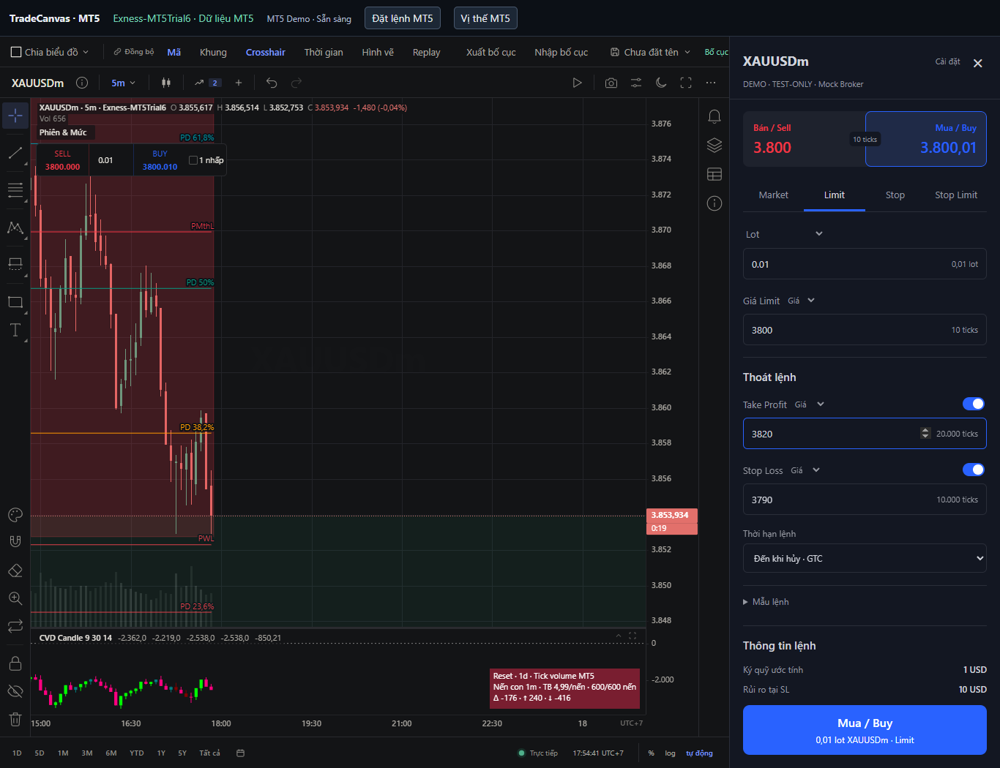

# TradeCanvas · MT5



[Light theme](screenshots/order-panel-light.png) · [Phone layout](screenshots/order-panel-phone.png). These screenshots use a mocked trading account; no account keys or personal balances are included.

Run `start.cmd` with MetaTrader 5 already open. The chart listens on `0.0.0.0:8772` and refreshes candles, CVD, quotes, positions and pending orders every second.

## Setup on Windows

Use 64-bit Python 3.11+ and Node 20.19+. Open MetaTrader 5 in the same Windows session, with the symbols you need visible in Market Watch.

```powershell
python -m venv .venv
.venv\Scripts\python -m pip install -r requirements.txt
npm ci --ignore-scripts
start.cmd
```

The launcher prefers `.venv`; an existing Codex Python runtime or `python` on PATH is the fallback. A separate installed dependency directory can be supplied with `MT5_CHART_DEPS`. Open `http://localhost:8772` on the host or `http://<host-LAN-IP>:8772` on another device. The chart attaches to the terminal already running; it does not require storing account passwords in source files.

## Trading

- **Đặt lệnh MT5** opens a resizable-chart sidebar ticket with live Buy/Ask and Sell/Bid prices, Market/Limit/Stop/Stop Limit tabs, exits, deadlines and local order presets. Price appears above the Buy/Sell caption. Unsupported order types/validity are disabled according to the MT5 symbol's flags.
- Choose **Pip** to enter a price distance and see the converted price. For pending Entry and Stop, a positive distance is above the displayed Ask (Buy) or Bid (Sell). The edit dialog uses the quote shown when it opens. SL/TP use the order's Entry as the reference and keep their pip distance when editing a pending Entry. In the SL field, a negative pip value can represent a profit-locking stop on an open position. For XAUUSDm, 100 pips equal 1.00 price unit. Conversion uses the instrument's pip size and rounds to its MT5 tick. [Exness pip specifications](https://get.exness.help/hc/en-us/articles/360014740179-Common-trading-terms).
- Choose quantity in **lots**, account-currency value, percent of balance, account-currency risk or percent-of-balance risk. MT5 `order_calc_profit` and `order_calc_margin` provide account-currency estimates. Risk sizing requires an SL and rounds volume down to the broker's step. Estimates exclude commission, swap and slippage; margin estimates do not net the current positions.
- Right-click a **Long/Short Position** drawing and choose **Tạo lệnh giới hạn MT5 từ vị thế…** to copy Entry, SL, TP, side and the risk mode. The order draft and the linked drawing update each other. The drawing tool's abstract quantity is never interpreted as broker lots.
- Right-click the chart or use the price-axis plus menu to prepare Buy/Sell Limit, Stop or Stop Limit orders at the selected price.
- **Middle mouse drag**: hold the middle mouse button (press the scroll wheel) on an Entry line or its label, then drag to create or replace SL on the loss side or TP on the profit side. No toggle is required, including when neither exit exists yet. It works on drafts, pending orders (including Stop Limit) and filled positions; filled Entry stays fixed. The native close/cancel buttons keep their own actions. Release follows the current confirmation/one-click setting for existing trades; editing a draft sends nothing. Escape cancels an existing-trade drag.
- For a **filled position**, left-drag or middle-drag its Entry line or label to create or replace an exit. The fixed Entry stays in place. The drop's side of the closing quote (Bid for Buy, Ask for Sell) decides SL or TP, so an SL can lock in an existing profit.
- For **pending orders and drafts**, turn on **SL/TP** to left-drag Entry and create or replace an exit. With the button off, a left-button Entry drag moves the bracket by the same price difference and preserves reward/risk. Stop Limit also moves its activation price. Left-drag an SL/TP line directly to change only that exit. Escape, a drawing/eraser/zoom tool, account or symbol changes reset the mode. It is per chart and never persisted. Drawing/eraser/zoom tools also suspend order drags. Shift keeps measurement/angle constraints, Ctrl/Meta keeps drawing copy/selection and Alt keeps the pinned OHLC tooltip.
- **Vị thế MT5** shows the current terminal account, broker-reported P&L, positions and pending orders across symbols. Use it to modify SL/TP, modify a pending order's price, cancel an order or close a full position. Chart order/position lines also route changes through this connection.
- Chart lines have no floating **TP / SL / Hạn** button groups. Add or replace exits with a middle-button Entry drag, or use the order ticket / **Vị thế MT5** panel. Existing SL/TP lines remain directly draggable. While dragging an exit, a chart label shows its proposed price and its distance from Entry in the symbol's pips.
- **Compact trade labels** show side, lots and MT5-reported position P/L in the account currency; pending orders show their type instead of a floating P/L. Prices remain on the price axis. Hover a label or line to highlight its Entry/SL/TP and dim the other trades; click to keep that selection, and click an empty area or press Escape to clear it. The hover tooltip shows the ticket, exact levels and deadline in the chart timezone. Selecting or hovering sends nothing.
- Crowded labels spread into rows inside the price pane, with connectors back to their actual price; a short pane adds columns and truncates long text, while the tooltip retains the full details. Dragging a displaced label uses its original price anchor. Close/cancel/remove-stop buttons retain their individual ticket identities. Focus clears when its trade disappears or the account/symbol changes, and drawing/eraser/zoom tools keep their gestures.
- **One-click trading** is off by default. The chart's red Sell / lot input / blue Buy controls open the ticket while it is off. Change it under **Chart Settings → Trading → One-click trading** or the ticket's **Cài đặt** menu; it is no longer inside the price-button strip. When enabled, completed live-order drags and trade/cancel/close actions submit immediately. The choice is per account and browser tab, retained on reload, and disarmed if the account changes. Draft edits and drawing operations never submit on their own.
- **Price guards** use Ask for buy entries and Bid for sell entries, the broker's stop distance, and the current closing quote (Bid for a buy position; Ask for a sell position) for live exits. A position's SL can protect an existing profit, and its TP can limit an existing loss; validity follows the current quote rather than the old entry. Invalid form values disable submission before any preflight request. Moving a draft across the market flips Buy/Sell and mirrors its bracket. Crossing an exit over a draft Entry also updates its side/type to a valid pending family. Already placed MT5 orders retain their immutable side/type, and filled positions never reverse through an exit drag: their dragged levels are constrained to valid prices. The backend repeats the checks before MT5 `order_check`.
- Every submission still calls MT5 `order_check` and verifies the account again immediately before `order_send`. With One-click off, the exact account, symbol, lots and action appear for review; **Gửi tới MT5** submits it. There is no automatic retry after a send failure. Check the terminal before creating another request if a result is uncertain.
- MT5 **Algo Trading** must be enabled. In Tools → Options → Expert Advisors, the external Python trading API must also be allowed. The chart reports the current permission state; it does not change MT5 permissions.
- There is no chart-managed trailing stop or automatic position reversal in this connection.

Trading requests require a key, exact same-origin JSON requests and a matching current account. Browsers on the MT5 computer connect automatically. For another LAN device, open **Vị thế MT5 → Mã kết nối máy khác** on the MT5 computer to view the key, then enter it on that device. The key is stored in `.trading-key`; it is not included in exported chart layouts. `.trading-requests.sqlite3` records request IDs and trade deadlines, including across server restarts. Keep these files private and retain the request database.

## Trade deadlines and quote lines

**Thời hạn lệnh** is available for Market orders and pending orders. Select no deadline, the end of the day in the chart timezone, or a specific date/time. Switch between **24 giờ** and **AM / PM**; the form and chart labels follow **the chart's timezone setting**, while the server stores UTC milliseconds. Ambiguous or nonexistent local DST times require an explicit UTC/offset timezone.

For an existing position or order, click **Thời hạn** in **Vị thế MT5**. A scheduled deadline appears as a vertical line that can be dragged horizontally; the sidebar draft follows the same marker. A marker outside the view sits at the edge with an arrow and its exact time. Setting or moving a live deadline uses the same review/one-click mode as other trade changes.

Pending orders use native broker expiration when supported; host tracking follows the opening order's `position_id` if it fills before the deadline. At the deadline, the host cancels an unfilled order or closes the remaining position at market. **The host and MT5 must be running and allowed to trade.** Disconnection retains the deadline for reconnection; disabled Algo Trading displays a waiting state. A send with an uncertain result, rejection or partial fill is reported and not blindly resubmitted. If the position volume increased beyond the amount authorized when scheduling, the timer stops and requires the user to set its deadline again. Closing time/price is subject to connection, permissions, market opening and broker execution; it is not a guaranteed price or exact fill time.

Under **Chart Settings → Symbol → Last price**, **Đường giá** controls the native Bid line and its optional Ask companion. There is one **Đường giá Ask** checkbox, shown only while the price line is enabled. **Màu Bid** and **Màu Ask** replace the direction-based Up/Down colors; both lines share the same dash and width. Bid keeps its chosen color when the market moves down, and no duplicate Bid overlay is drawn. Live quotes update each second; replay uses its historical last price and hides live Ask. The Ask choice, native line styles and 12/24-hour clock preference are saved per chart in named/imported/shared layouts, with cancellation restoring previous values. Legacy layouts' separate Bid flag is ignored. Loading a layout never creates a trade deadline or enables One-click.

## Seasonal session hours

In **All-In-One Sessions → Phiên giao dịch**, **Châu Á, London and New York** have separate editable start/end pairs for **Mùa hè** and **Mùa đông**. All four times use **Múi giờ phiên**, including fixed UTC/GMT offsets. The indicator automatically chooses the appropriate pair for each historical bar. **Asia and London follow the London season calendar** (`Europe/London`), allowing the custom Asian range to close at the European open. New York follows `America/New_York`, including the weeks when UK and US seasons differ. There is no manual season dropdown or automatic-switch checkbox. All hours remain independently editable; changing London's hours does not overwrite Asia's hours. Each indicator instance saves its own pairs, including Sessions on CVD.

Old layouts retain their entered summer hours and any separate winter hours. Missing winter fields are suggested once from the saved pair: both boundaries one hour later for London/New York; the same opening and a closing one hour later for Asia. Either pair can then be edited freely, including overnight hours; no extra hour is added to an explicitly entered winter pair. Former manual-season and automatic-DST flags are discarded. Session boxes, opening lines, previous-session Fibonacci and retained history all use the same date-dependent schedule. The six custom level windows retain their existing single pair of hours. Calendar references: [UK clock changes](https://www.gov.uk/when-do-the-clocks-change), [NIST US DST rules](https://www.nist.gov/pml/time-and-frequency-division/popular-links/daylight-saving-time-dst).

## Sessions Fibonacci history

In All-In-One Sessions → **Fibonacci phiên trước**, enable **Giữ Fibo phiên cũ**. Each completed session retains its selected levels inside its own time range. This is separate from **Giữ hộp phiên cũ** and is saved independently for each Sessions indicator instance and layout. Incomplete CVD history does not produce invented Fibo extremes.

Sessions and day/week/month Fibonacci settings now include **0%** and **100%** with independent visibility and colors. Endpoints always denote Low and High: **PAL/PAH**, **PLDL/PLDH**, **PNYL/PNYH** for previous Asia/London/New York, and the period's usual Low/High names (PDL/PDH, PWL/PWH, etc.). The direction setting reverses the internal retracement levels. Period lines have their own border color/width. The old separate midpoint setting is removed; its saved enabled value migrates to the period's Fibonacci **50%**, avoiding duplicate lines.

Line and border thickness accept fractional pixels in **0.05 px** increments, including **0.25** and **0.5 px**. **Độ dày viền chữ** controls period labels; **Độ dày viền số Fibo** controls session Fibonacci labels. Both default to **1 px** instead of the former fixed 4 px; **0** disables the text outline while retaining its fill color. Each indicator instance and saved layout retains its own values.

## Shared layouts over LAN

Named layouts are stored on the MT5 host in `layouts/layouts.sqlite3`, independently of any browser. Every LAN client uses the same save/open/rename/delete menu and sees updates to the shared list within about one second. A fresh browser opens the most recently saved layout; each browser subsequently remembers which layout it opened.

The first load of this version uploads the browser's existing named layouts. The original browser records remain intact. If two browser archives have different versions of the same ID, both are preserved, with a separate shared ID for the conflicting copy. Original save dates and browser timezone/Sessions settings are retained. A migration is idempotent and does not recreate a layout subsequently deleted from the shared store.

Opening a chart on one device does not move another device's chart or discard its edits. When the same saved layout changes remotely, **Mở bản máy chính** loads the newer version and **Lưu thành bản mới** keeps the local chart as another layout. Saving an older version over a newer one is rejected. Auto-save uses the same revision checks. The database retains previous saved versions and deleted content in its internal history table.

The **Xuất bố cục / Nhập bố cục** JSON controls still work with this shared store. To back up the complete shared collection and its history, stop the host and copy the `layouts` directory. `bridge.py --layout-dir PATH` selects another data directory, including a separate empty one for isolated browser tests. Layout sharing does not grant access to MT5 trading; trading keeps its separate connection key.

## Verification

```powershell
.venv\Scripts\python -m unittest -v test_mt5_trading.py test_trade_expiry.py test_layout_store.py
npm run test:unit
$env:TRADECANVAS_URL='http://127.0.0.1:8773/'
npm run test:trading
npm run test:layouts
$env:MT5_CHART_PYTHON=(Resolve-Path .venv\Scripts\python.exe).Path
npm run test:ui
```

Start an isolated test server on 8773 with `bridge.py --host 127.0.0.1 --port 8773 --layout-dir <empty-test-directory>` so browser tests never write into personal shared layouts. The trading browser fixtures intercept **every** trading route; the Python tests replace the terminal with a fake broker, including `order_send`. They never send a real terminal order. UI tests use an installed Chrome at `C:/Program Files/Google/Chrome/Application/chrome.exe`; the visual check covers phone, laptop and wide screens, light/dark themes and Print/Studio/Terminal looks. Mock-account screenshots are under `screenshots/`.

`test:ui` starts a separate hidden test server with a temporary layout store for each file. Browser UI fixtures also supply deterministic market data and block trading mutations, so an open MT5 terminal is not needed for those tests.

## Sources and notices

The host uses upstream's chart grid, named layouts, drawing tools, execution adapter, Long/Short geometry and time-zone calculations. The MT5 integration supplies the terminal feed, broker order validation and lot sizing, timed exits, the Sessions and CVD plugins, and shared LAN storage.

The application uses published `@tradecanvas/chart@2.16.0`. Its order UI is an independent implementation based on TradingView's public [Order Ticket documentation](https://www.tradingview.com/charting-library-docs/latest/trading_terminal/order-ticket/) and [order-projection behavior](https://www.tradingview.com/support/solutions/43000736178-chart-trading-order-projection/). The [Lightweight Charts source](https://github.com/tradingview/lightweight-charts/tree/c29c51e1e5bc61981da5832c97797cb8283d120f) was inspected; it is a chart renderer and does not supply this ticket. No proprietary TradingView Trading Platform source is included.

`cvd.js` and `cvd_volume.py` retain their MPL 2.0 notices and attribution to TradingView's CVD Candle script. `session-levels.js` retains the attribution to Texmoonbeam's Pine indicator supplied for the port. The indicator ports are JavaScript/Python implementations over MT5 data, not a Pine Script runtime. Broker tick-volume CVD is an estimate from quote direction, not exchange-provided bid/ask trade delta.
